# Домашнее задание к занятию 11 «Teamcity»

# Боровиков Максим

## Подготовка к выполнению

1. В Yandex Cloud создайте новый инстанс (4CPU4RAM) на основе образа `jetbrains/teamcity-server`.
2. Дождитесь запуска teamcity, выполните первоначальную настройку.
3. Создайте ещё один инстанс (2CPU4RAM) на основе образа `jetbrains/teamcity-agent`. Пропишите к нему переменную окружения `SERVER_URL: "http://<teamcity_url>:8111"`.
4. Авторизуйте агент.
5. Сделайте fork [репозитория](https://github.com/aragastmatb/example-teamcity).
6. Создайте VM (2CPU4RAM) и запустите [playbook](./infrastructure).

## Основная часть

Поднимал через [docker](img/../docker-compose.yml)

```bash
mkdir -p ~/teamcity/{data,logs,agent/{conf,work,temp}}
mkdir -p ~/nexus/data
chown -R maks:docker ~/teamcity
chown -R 200:200 ~/nexus/data
```

1. Создайте новый проект в teamcity на основе fork.

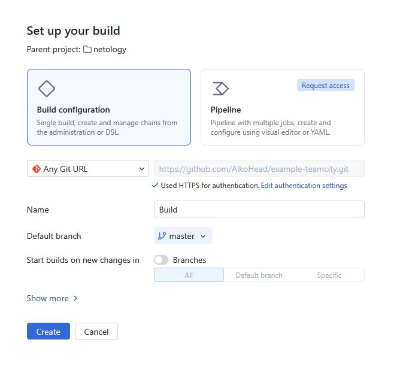

2. Сделайте autodetect конфигурации.

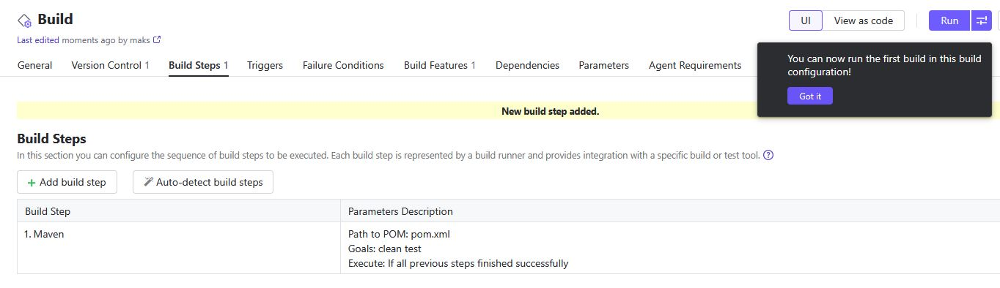

3. Сохраните необходимые шаги, запустите первую сборку master.

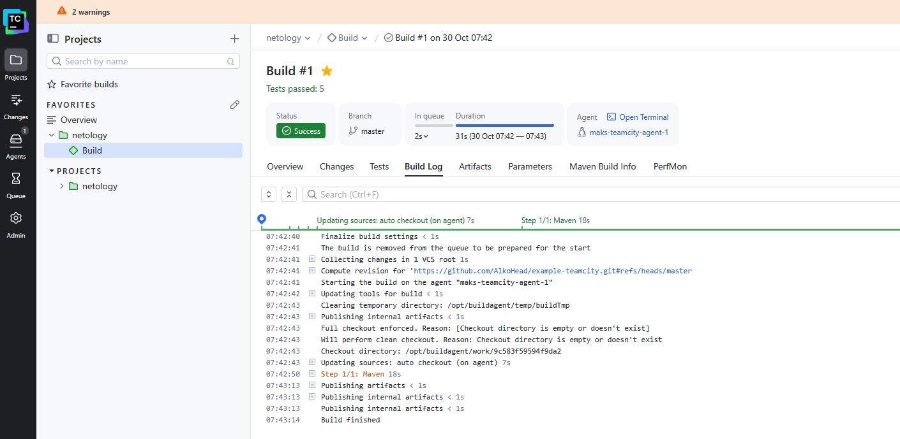

4. Поменяйте условия сборки: если сборка по ветке `master`, то должен происходит `mvn clean deploy`, иначе `mvn clean test`.

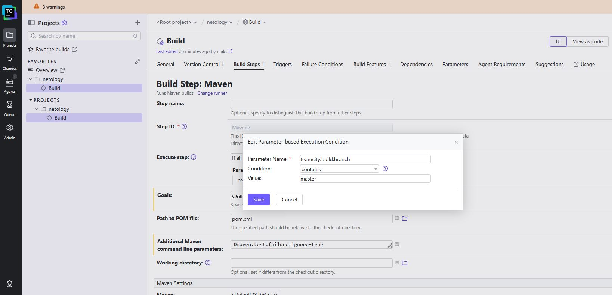

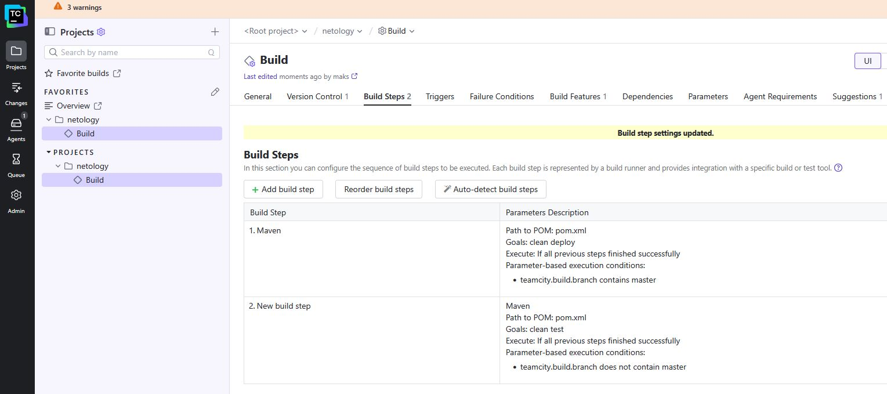

5. Для deploy будет необходимо загрузить [settings.xml](./teamcity/settings.xml) в набор конфигураций maven у teamcity, предварительно записав туда креды для подключения к nexus.

```text
    <server>
      <id>nexus</id>
      <username>admin</username>
      <password>ПАРОЛЬ</password>
    </server>
```

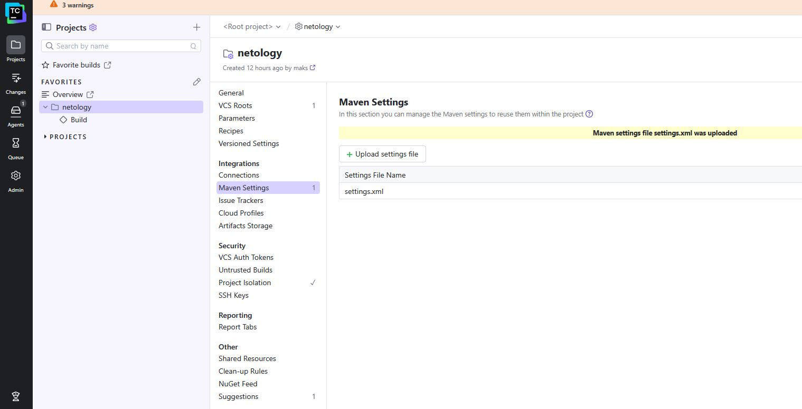

6. В pom.xml необходимо поменять ссылки на репозиторий и nexus.

 в моём случае, т.к. nexus в докере

```text
<distributionManagement>
		<repository>
				<id>nexus</id>
				<url>http://nexus:8081/repository/maven-releases</url>
		</repository>
</distributionManagement>
```

7. Запустите сборку по master, убедитесь, что всё прошло успешно и артефакт появился в nexus.


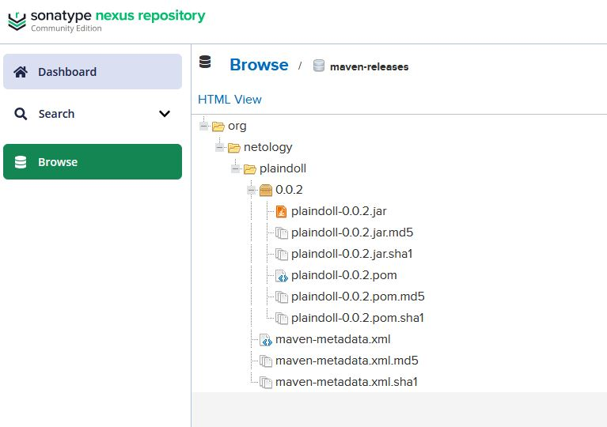

8. Мигрируйте `build configuration` в репозиторий.

Т.К. не было настроин git,  
в ЛК github был сделан Personal access tokens (classic)  
(settigs - Developer settings - Personal access tokens - Generation new token (classic))  
Токен был добавлен в VCS Roots, раздел Authentication Settings  
Далее  

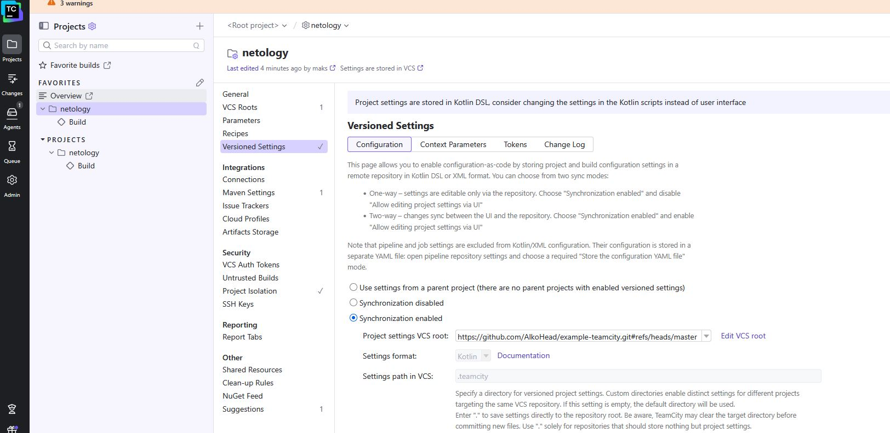

9. Создайте отдельную ветку `feature/add_reply` в репозитории.

```bash
git checkout -b feature/add_reply
```

10. Напишите новый метод для класса Welcomer: метод должен возвращать произвольную реплику, содержащую слово `hunter`.

В файл:

```text
src/test/java/plaindoll/WelcomerTest.java
```

добавил

```text
public String sayHunterReply() {
    return "The hunter is ready for a new journey.";
}
```

11. Дополните тест для нового метода на поиск слова `hunter` в новой реплике.

В файл:

```text
src/test/java/plaindoll/WelcomerTest.java
```

добавлен тест:

```text
@Test
public void welcomerSaysHunterReply() {
    assertThat(welcomer.sayHunterReply(), containsString("hunter"));
}
```

12. Сделайте push всех изменений в новую ветку репозитория.

Изменения отправлены в ветку:

```text
git add src/main/java/plaindoll/Welcomer.java src/test/java/plaindoll/WelcomerTest.java
git commit -m "Add hunter reply"
git push -u origin feature/add_reply
```

13. Убедитесь, что сборка самостоятельно запустилась, тесты прошли успешно.

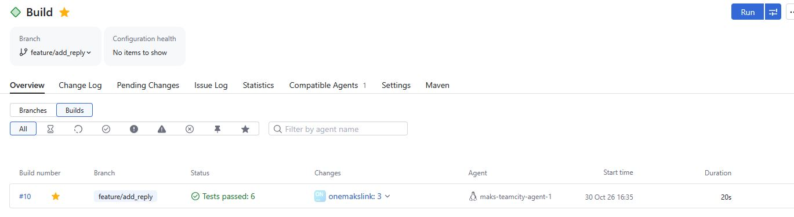

14. Внесите изменения из произвольной ветки `feature/add_reply` в `master` через `Merge`.

```bash
git checkout master
git pull origin master
git merge --no-ff feature/add_reply -m "Merge feature/add_reply"
git push origin master
```

15. Убедитесь, что нет собранного артефакта в сборке по ветке `master`.

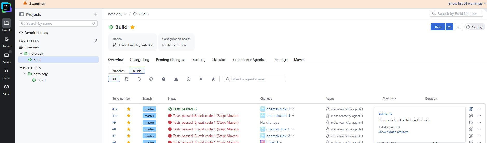

16. Настройте конфигурацию так, чтобы она собирала `.jar` в артефакты сборки.

```txt
target/*.jar => build-artifacts
```

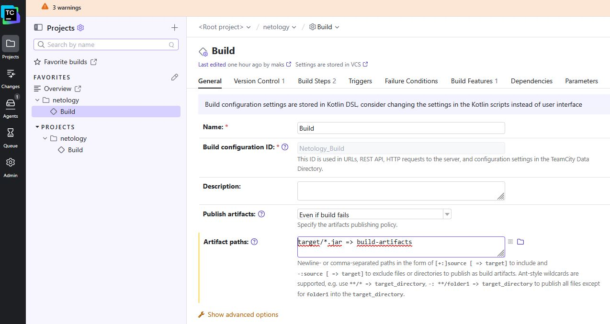

17. Проведите повторную сборку мастера, убедитесь, что сбора прошла успешно и артефакты собраны.

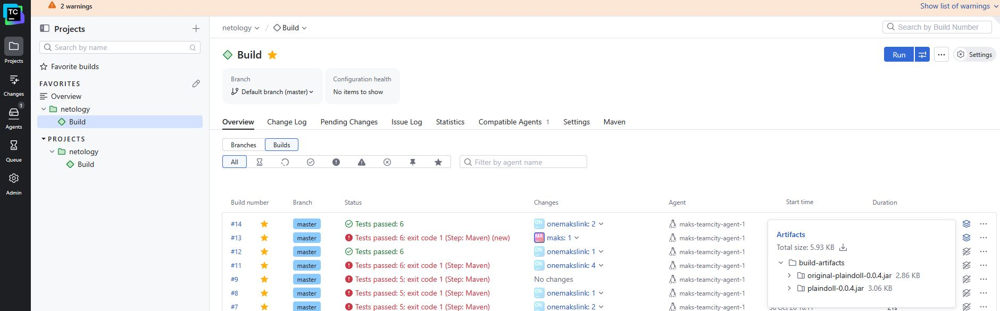

18. Проверьте, что конфигурация в репозитории содержит все настройки конфигурации из teamcity.

19. В ответе пришлите ссылку на репозиторий.

[Ссылка на репозиторий](https://github.com/AlkoHead/example-teamcity/tree/master) 


---

### Как оформить решение задания

Выполненное домашнее задание пришлите в виде ссылки на .md-файл в вашем репозитории.

---
