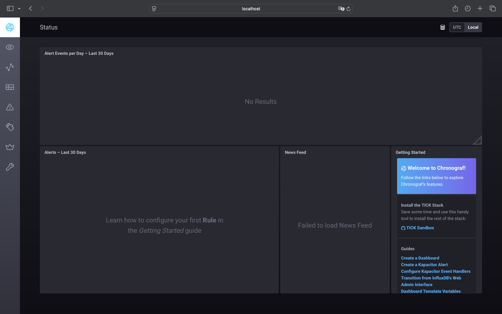
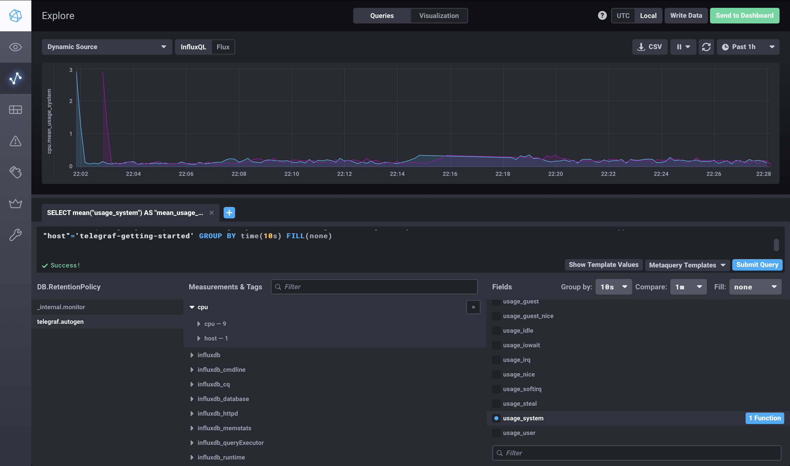
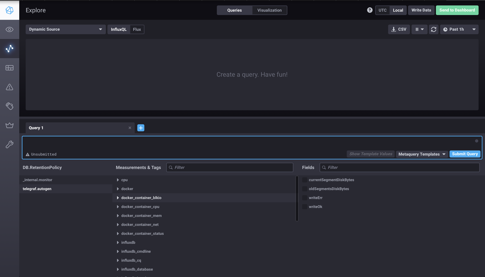

# Домашнее задание к занятию "13.Системы мониторинга"

# Боровиков Максим

## Обязательные задания

---------------

1. Вас пригласили настроить мониторинг на проект. На онбординге вам рассказали, что проект представляет из себя 
платформу для вычислений с выдачей текстовых отчетов, которые сохраняются на диск. Взаимодействие с платформой 
осуществляется по протоколу http. Также вам отметили, что вычисления загружают ЦПУ. Какой минимальный набор метрик вы
выведите в мониторинг и почему?

Ответ:

1. Загрузка ЦПУ (CPU Usage)

 - Высокая загрузка процессора указывает на интенсивное использование ресурсов, что может привести к замедлению работы системы или сбоям.

2. Время отклика (Response Time) и активных запросов (Active Requests)

 - Это позволяет оценить, насколько быстро система обрабатывает запросы и планировать ресурсы в зависимости от количества одновременно обрабатываемых запросов.

3. Использование памяти (Memory Usage)

 - Мониторинг использования оперативной памяти позволяет предотвратить утечки памяти и обеспечить стабильную работу системы.

4. Ошибки (Errors)

 - Отслеживание количества ошибок помогает выявлять проблемы в системе и оперативно реагировать на них.

5. Метрики хранилища (Storage Metrics):

 - Общий объем хранилища (Total Storage)
 - Используемое пространство (Used Space)
 - Свободное пространство (Free Space)
 - Скорость чтения и записи (Read/Write Speed)
 - Число операций ввода-вывода в секунду (IOPS)

6. Время безотказной работы (Up Time):

 - Помогает оценить, насколько долго сервисы остаются доступными без сбоев.

------

2. Менеджер продукта посмотрев на ваши метрики сказал, что ему непонятно что такое RAM/inodes/CPUla. Также он сказал, 
что хочет понимать, насколько мы выполняем свои обязанности перед клиентами и какое качество обслуживания. Что вы 
можете ему предложить?

Ответ:

На дашборде для менеджера продукта можно сделать 3 крупных виджета:

1. SLI: 99.7% (зелёный) — текущий процент 2xx‑запросов.

2. SLO: 99.5% — цель, которую команда себе поставила.

3. SLA: Доля ошибок сервера не должна превышать 1% за календарный месяц


SLI (Service Level Indicator — Индикатор уровня обслуживания) = число запросов со статусом 2xx/общее число HTTP‑запросов * 100%

- «Процент успешных HTTP-запросов»

SLO (Service Level Objective — Целевой уровень обслуживания) = HTTP-запросов 2XX/общее число HTTP‑запросов < 0.995

SLA (Service Level Agreement — Соглашение об уровне обслуживания) = количество 5XX/ общее число HTTP‑запросов * 100%

--------------

3. Вашей DevOps команде в этом году не выделили финансирование на построение системы сбора логов. Разработчики в свою 
очередь хотят видеть все ошибки, которые выдают их приложения. Какое решение вы можете предпринять в этой ситуации, 
чтобы разработчики получали ошибки приложения?

Ответ:
 - Zabbix
 - Скрипт

--------------

4. Вы, как опытный SRE, сделали мониторинг, куда вывели отображения выполнения SLA=99% по http кодам ответов. 
Вычисляете этот параметр по следующей формуле: summ_2xx_requests/summ_all_requests. Данный параметр не поднимается выше 
70%, но при этом в вашей системе нет кодов ответа 5xx и 4xx. Где у вас ошибка?

Ответ:

Не учитываются 3ХХ и 1XX ответовы HTTP.

---------------

5. Опишите основные плюсы и минусы pull и push систем мониторинга.

Ответ:

Pull‑модель (сервер «забирает» данные)

Плюсы:

- Централизованный контроль сбора.
- Встроенные механизмы обнаружения.
- Меньше нагрузки на целевые сервисы.

Минусы:

- Требует сетевой доступности целей для сервера.
- Не подходит, если цель «недоступна» для внешнего опроса.
- Риск «пропущенных» коротких событий.
- Зависимость от доступности сервера мониторинга.

Push‑модель (цель «отправляет» данные)

Плюсы:

- Работает в сетях, где сервер не может доходить до целей.
- Подходит для изолированных сегментов
- Легче масштабировать число целей.
- Можно отправлять более «богатые» данные.

Минусы:

- Сложнее контролировать и стандартизировать.
- Больше нагрузки на цели. 
- Проблемы с доставкой и буферизацией.
- Безопасность и аутентификация. 

------------

6. Какие из ниже перечисленных систем относятся к push модели, а какие к pull? А может есть гибридные?

    - Prometheus 
    - TICK
    - Zabbix
    - VictoriaMetrics
    - Nagios

Ответ:

- Push
- > TICK
- Pull
- > Prometheus
- > Nagios
- Push и Pull
- > Zabbix
- > VictoriaMetrics

-----------------

7. Склонируйте себе [репозиторий](https://github.com/influxdata/sandbox/tree/master) и запустите TICK-стэк, 
используя технологии docker и docker-compose.

В виде решения на это упражнение приведите скриншот веб-интерфейса ПО chronograf (`http://localhost:8888`). 

P.S.: если при запуске некоторые контейнеры будут падать с ошибкой - проставьте им режим `Z`, например
`./data:/var/lib:Z`



-------------------

8. Перейдите в веб-интерфейс Chronograf (http://localhost:8888) и откройте вкладку Data explorer.
        
    - Нажмите на кнопку Add a query
    - Изучите вывод интерфейса и выберите БД telegraf.autogen
    - В `measurments` выберите cpu->host->telegraf-getting-started, а в `fields` выберите usage_system. Внизу появится график утилизации cpu.
    - Вверху вы можете увидеть запрос, аналогичный SQL-синтаксису. Поэкспериментируйте с запросом, попробуйте изменить группировку и интервал наблюдений.

Для выполнения задания приведите скриншот с отображением метрик утилизации cpu из веб-интерфейса.



------------------

9. Изучите список [telegraf inputs](https://github.com/influxdata/telegraf/tree/master/plugins/inputs). 
Добавьте в конфигурацию telegraf следующий плагин - [docker](https://github.com/influxdata/telegraf/tree/master/plugins/inputs/docker):
```
[[inputs.docker]]
  endpoint = "unix:///var/run/docker.sock"
```

Дополнительно вам может потребоваться донастройка контейнера telegraf в `docker-compose.yml` дополнительного volume и 
режима privileged:
```
  telegraf:
    image: telegraf:1.4.0
    privileged: true
    volumes:
      - ./etc/telegraf.conf:/etc/telegraf/telegraf.conf:Z
      - /var/run/docker.sock:/var/run/docker.sock:Z
    links:
      - influxdb
    ports:
      - "8092:8092/udp"
      - "8094:8094"
      - "8125:8125/udp"
```

После настройке перезапустите telegraf, обновите веб интерфейс и приведите скриншотом список `measurments` в 
веб-интерфейсе базы telegraf.autogen . Там должны появиться метрики, связанные с docker.

Факультативно можете изучить какие метрики собирает telegraf после выполнения данного задания.



